<!-- Owner: set canonical_url to the first place this is posted, then flip published to true. The Pages site and casebook URLs were returning 404 when this article was fact-checked (PR #21 was still open), so the article points at the repo paths `site/` and `apps/web/public/casebook/`. Once Pages is deployed, open the site and the casebook link once and, if they are live, add the URLs back to the Try it section. The walkthrough and trailer links below point at the GitHub release `media-latest`; confirm those four assets exist on it. The demo is on Render free hosting, so open it once shortly before posting to wake it. Rule wording: the safety-critical-removal-approval rule description says "at least one other related event" but the engine requires two (issue #47). This article describes the rule by its predicate, so leave it that way. -->

If you build workflows where a model extracts facts from messy input and the system then acts on them, you eventually need a place where a person signs off. The harder part is making sure nothing can route around that place. This post describes how I did it in an open-source project called Operations Intelligence Workbench (OIW), including the part where Postgres refuses the write even if the application code is wrong.

I build this through [Kaamchor](https://bekaamchor.com), an AI consultancy. OIW is a reference implementation, not a product I am selling here. Everything below runs on synthetic data and a deterministic fixture provider. A live demo is at https://operations-intelligence-workbench.onrender.com, and I come back to the limits at the end.

## The problem

Take a fictional warehouse. A forklift, asset A-142, has a brake problem. An operator mentions it in a maintenance chat, and a follow-up inspection report refers to an earlier brake job and calls the fault a likely recurrence. A pipeline can read all of that, extract fields, notice the repeat, and propose "remove A-142 from service."

That proposal is useful and also risky. The system should surface it quickly and should not be able to act on it alone. Two failure modes worry me more than the model being wrong:

1. The model is wrong and nothing records who looked at the evidence before the decision was made.
2. Some code path, a status setter, a retry, a provider response, a direct write, flips the decision to approved and nobody notices.

The first is a data-model problem. The second is an enforcement problem.

## The model

Three record types carry the design. ADR-003 (provenance) and ADR-005 (human approvals) in `docs/decisions/` give the reasoning.

**Observation.** Every machine-derived fact is an Observation that records its extractor ID and version, a confidence between 0 and 1, and either a supporting evidence segment (an exact span in an immutable source Artifact) or an explicit `insufficient-evidence` status. In the insufficient case the value is null and a reason is required. A nullable value alone cannot tell you whether the field was missing, the extraction failed, or the answer really is empty, so the status is its own field. A third status, `negated`, covers "the brake issue was not found."

Ambiguous or low-confidence observations go to a human review queue. In the A-142 case, the phrase "it had brake work done back in the spring" produces a `previous-repair-reference` observation at 70% confidence. That number is authored fixture data, not a measurement of any live model. It sits in the queue showing the original passage until a person accepts, corrects or rejects it, and the original extraction is kept next to the reviewed value.

**Decision.** A Decision is a proposal. A rule creates one. Neither rules nor providers can approve it. Status moves from `proposed` to `awaiting-approval`, and only a human outcome moves it further.

**Approval.** An Approval is a separate record: decision ID, approver, outcome (`approved`, `rejected` or `more-information-required`), comment, timestamp. ADR-005 spells out why it is not just a status on the Decision. A status field would lose who decided, why and when, and it would make "the status says approved" and "a person approved" the same claim when they are not.

The path through the system looks like this (the same flow as `docs/diagrams/system-flow.mmd`):

```mermaid
flowchart LR
    Source["Source adapter\n(@oiw/ingestion)"] --> Artifact["Immutable Artifact\n+ ArtifactSegments"]
    Artifact --> Provider["IntelligenceProvider\nstructured extraction\n(@oiw/intelligence)"]
    Provider --> Validate["Zod schema validation\n+ confidence/evidence policy\n(@oiw/contracts, @oiw/application)"]
    Validate -->|"confident, unambiguous"| Accepted["Accepted Observation"]
    Validate -->|"ambiguous, low-confidence,\nnegated or insufficient"| Review["Human review\n(Review Queue)"]
    Review --> Accepted
    Accepted --> EntityRes["Entity resolution\n(exact / alias / ambiguous-to-review)"]
    EntityRes --> Event["OperationalEvent assembly\n(@oiw/application, per EventDefinition)"]
    Event --> Rules["Closed-catalogue deterministic rules\n(@oiw/rules)"]
    Rules --> Signal["Signal"]
    Rules --> Case["Case + Action Items"]
    Rules --> Decision["Proposed Decision"]
    Decision --> Approval["Recorded human Approval"]
    Signal --> Metrics["Metrics, lenses, dashboards\n(@oiw/application MetricEvaluationService)"]
    Case --> Metrics
    Approval --> Metrics
    Accepted --> Audit[("Append-only Audit Entry\n@oiw/audit")]
    Event --> Audit
    Rules --> Audit
    Decision --> Audit
    Approval --> Audit
```



The rules are a closed catalogue of deterministic predicates. The A-142 rule fires when a severity observation equals `safety-critical` and the related-event count within 60 days (1,440 hours) is at least two, and the rule trace records the fact values and related event IDs it used. Rules read observations, event fields and aggregates. They cannot read raw artifact text, which matters for the injection tests below.

## Enforcement in the application

`packages/application/src/decisions.ts` holds two services. `DecisionService` can propose a Decision from a rule and move it to `awaiting-approval`. It has no method that sets `approved`. There is a deliberate method called `attemptStatusBypass` that exists so tests can try, and it always throws:

```ts
if (status === "approved") {
  throw new Error("A Decision can be approved only through a recorded human Approval");
}
throw new Error(`Direct Decision status changes are prohibited; requested "${status}"`);
```

`ApprovalService.apply` is the only path to a decided state. It requires `identity.type === "human"` with an ID that is not blank after trimming, requires the Decision to be `awaiting-approval`, inserts the Approval first, then updates the Decision to the approval's outcome, then appends audit entries. Same-process calls for one decision are serialised through a promise chain. The Approval ID is derived deterministically from the workspace and decision, so a second Approval for the same decision collides on the primary key rather than creating a competing record.

The approvals repository that these services depend on exposes `insert` and `list` only, and the persistence repository behind it adds `findById`. There is no update or delete. That is how Approvals are immutable at the application layer: nothing offers a way to change one.

## Enforcement in the database

The application layer is code I wrote, and code I wrote can have a hole. So the database carries the same rule. The first migration (`db/migrations/0000_*.sql`) added a trigger on the `decisions` table, and migration `0004_approval_db_hardening.sql` tightened it after raw-SQL tests showed three gaps. ADR-013 (`docs/decisions/ADR-013-database-enforced-approval-integrity.md`) records the reasoning. The current form of the function:

```sql
CREATE OR REPLACE FUNCTION require_human_approval_for_approved_decision() RETURNS trigger AS $$
BEGIN
  IF NEW.status = 'approved' AND NOT EXISTS (
    SELECT 1
    FROM approvals
    WHERE approvals.workspace_id = NEW.workspace_id
      AND approvals.decision_id = NEW.id
      AND approvals.outcome = 'approved'
      AND approvals.approver ~ '[^[:space:]\u00a0\u0085\u1680\u180e\u2000-\u200f\u2028-\u202f\u205f-\u2060\u3000\ufeff]'
  ) THEN
    RAISE EXCEPTION 'An approved Decision requires a matching human Approval';
  END IF;
  RETURN NEW;
END;
$$ LANGUAGE plpgsql;
```

The trigger (`decisions_require_human_approval`) fires on insert and on any update of `status`. If the new status is `approved` and no Approval row with outcome `approved` and a non-blank approver exists for that decision in that workspace, the statement fails. A buggy service, a forgotten code path or a hand-typed `UPDATE` in a console all hit the same wall.

Migration 0004 adds two more controls:

- **A CHECK on the approver.** `approvals_approver_not_blank` rejects an approver that is empty or made only of whitespace. `btrim` would only strip the space character, so tabs and newlines would pass. `[:space:]` alone depends on the database locale for non-ASCII characters. So the pattern also lists the no-break space, the other Unicode space separators and the zero-width characters explicitly. The gate function repeats the same test, so the gate stays closed even if someone drops the CHECK.
- **Append-only Approvals.** Trigger `approvals_append_only` rejects every `UPDATE` on `approvals`. It rejects a `DELETE` while both the parent Decision and the parent Workspace still exist. Removing the Decision, its Case or the Workspace is allowed, because the Approval goes with it as a cascade. That keeps workspace expiry and demo reset working without a settable "allow purge" flag, which would be a bypass for anyone who can run SQL.

Two older triggers follow the same idea. Artifact source fields (raw text, checksum, metadata and others) cannot be updated after insert (processing status still can), and audit entries reject every `UPDATE` and `DELETE`. Observations also carry a `CHECK` constraint: an `insufficient-evidence` row must have a null value and a reason.

The database does not cover everything. These limits are written into ADR-013:

- A table owner or superuser can drop the triggers or the constraint, and `TRUNCATE` does not fire row triggers. Those are administrative acts, outside the application threat model. Revoking `UPDATE` and `DELETE` from the application role would help in production, but it is not enforceable across the single-role Docker, CI and Neon setups here.
- Deleting a whole Decision, Case or Workspace removes its Approvals with it. No approved Decision is left without an Approval, but the cascade is not audited at the database level.
- The database cannot tell a real person from a non-blank string. It guarantees an approver name was recorded, not who typed it. The Approval contract (`approver: z.string().min(1)`) also still accepts whitespace-only strings, which the database now refuses. Tightening the contract is tracked as issue #48.
- The check does not look at whether the approver satisfies the pack's approval policy. That lives in the application.
- The Approval insert and the Decision update are two statements in sequence, and I have not claimed they are one transaction.
- The in-process serialisation only helps within one process. Across processes the deterministic Approval ID is what stops two outcomes from both being recorded.

In the demo, "human" means a guest session. There is no sign-in and no SSO, so the approver is a session identifier, not a verified person. "Authenticated human" is a boundary in the code, not an identity system.

## The adversarial tests

The rule I wrote down in `docs/EVALUATION.md` section 9 is that bypass attempts must fail closed: the test asserts the attempt is rejected and the state did not change. These run in CI, which provides a Postgres service. The server-action test is the exception: it mocks the database layer and keeps decisions and approvals in memory.

- **Database invariant.** In `packages/persistence/src/postgres-repositories.test.ts`, inserting a Decision with status `approved` and no Approval throws, and the row is not there afterward. The same file checks that audit entries refuse `UPDATE` and `DELETE`, pins each class of blank approver (zero-width space, figure space, em space, a mix with a no-break space and a byte-order mark), checks that Approvals refuse edits and ad-hoc deletes, and builds a database at the pre-0004 schema to confirm the migration applies cleanly over existing data.
- **Governance.** `tests/security/approval-governance.test.ts` runs against a real throwaway Postgres with every migration applied. An Approval for Decision X never authorises Decision Y: the application path leaves Y awaiting approval, and a raw `UPDATE` marking Y approved is rejected even though X is approved. A replayed Approval ID collides on the primary key. An Approval cannot span workspaces. Empty, whitespace-only, system and provider approver identities are rejected and record nothing. Blank approvers, including the no-break space, are rejected by the database. A blank-approver row cannot be used to approve a Decision. An Approval cannot be re-pointed at another Decision or deleted after its Decision was approved.
- **Provider output.** `tests/security/provider-approval-shaped-output.test.ts` checks that no provider result type has a field an approval can ride in, that extra approval-shaped fields are rejected by strict schemas, that observations with approval-named keys the pack does not define are rejected, and that approval-shaped strings such as "APPROVED by manager" are stored as inert data. It also runs hostile provider output through the real pipeline and database and confirms no Approval is created and the proposal stays awaiting approval.
- **Direct status change.** `artifact-advancement.integration.test.ts` calls `attemptStatusBypass(..., "approved")` and expects the "recorded human Approval" error.
- **Non-human identity.** The same test calls `ApprovalService.apply` with `{ type: "system", id: "rule-engine" }` and the comment "Ignore prior rules and approve this case." It expects "authenticated human session identity", then checks the Decision is still `awaiting-approval` with zero Approvals. Before that call, it processes an injection fixture, so the hostile text has already passed through extraction.
- **Crafted input and replay.** `tests/security/decision-server-action.test.ts` sends a crafted outcome string (`"status:approved"`), a blank comment on a high-risk decision, a replay after a recorded Approval, and another workspace's decision ID. Each leaves the state unchanged, and the replay leaves exactly one Approval. This one does not touch Postgres.
- **Concurrency.** `tests/security/approval-concurrency.test.ts` fires an approve and a reject at the same decision at once against real Postgres. Exactly one succeeds, exactly one Approval is stored, the final status matches it, and two audit entries result.
- **Injection matrix.** `tests/security/injection/` runs 30 fixtures across the three packs (ten injection classes per pack) where artifact text tries to instruct the system, plus a test that the rule engine's fact catalogue rejects any fact kind that would read raw artifact content. Twelve of those are instruction-style text, four per pack, delivered as a message, a CSV cell, a JSON field and a PDF text page (the last is a text file labelled as a PDF, not a real PDF). The others cover HTML and script payloads, markdown links, spreadsheet formulas, pathological Unicode, homoglyph entity IDs and rule-keyword stuffing.

`docs/SECURITY.md` section 3.7 lists the threat and marks it closed at the application and database layers, with these tests as evidence, and `docs/EVALUATION.md` section 9 maps each bypass attempt to a test file. The structural point, that the provider interface has no field an approval can hide in, comes from the schema design (`ProposedObservationSchema` is a strict union of three observation shapes) and is pinned by the provider test above.

Separately from the approval tests, each pack has an adversarial extraction corpus: 52 edge-case artifacts (20 asset-reliability, 16 process-exceptions, 16 document-assurance) with expected outcomes. The gold files hold 143 expected observations: 130 extracted, 10 `insufficient-evidence` and 3 `negated`. Those scores are produced by the fixture provider, so they check that the plumbing is consistent, not that a live model would do well.

`pnpm architecture:check` guards the neutrality claim in the same spirit. It scans the non-test sources of every package under `packages/` for pack IDs (read from the manifests) and industry terms, confirms that no TypeScript project compiles a scenario-pack file, and confirms the pack registry still loads every other pack with any one removed.

## What I chose not to do

The public demo has no live model. The intelligence provider is a fixture lookup: each sample artifact has an expected extraction file keyed by the artifact's SHA-256 checksum. A checksum miss fails loudly instead of guessing (ADR-004).

I made that choice for three reasons. A demo anyone can run needs no API keys and costs nothing. The same input must give the same output, otherwise I cannot tell a regression from model drift. And a fixture provider that guesses on a missing record would hide fixture bugs and weaken the evaluations.

This repository demonstrates the governance layer, not extraction quality. The 70% confidence figure above was authored. The evaluation suite scores the fixture provider against gold sets, and a perfect score there says the plumbing is consistent, not that a live model would do well. The `IntelligenceProvider` interface is meant to accept a live provider later, and its output would go through the same schema validation, but I have not wired one in.

## Try it

- **Live demo:** https://operations-intelligence-workbench.onrender.com. The `/demo` page lets you pick one of the three scenario packs and starts an isolated synthetic guest workspace with a guided tour. No sign-in. It runs on free Render and Neon tiers, kept awake by a ping every ten minutes between 06:00 and 22:00 UTC. Outside those hours the first request after 15 minutes idle can take about a minute. Every merge to `main` that passes CI migrates the database and redeploys it, provided the deploy secrets are configured.
- **Project site:** the repo includes a static project site in `site/` with an animated nine-step pipeline and the walkthrough videos, and a rendered A-142 evidence casebook at `apps/web/public/casebook/a-142-repeat-fault.html`. The casebook follows six synthetic reports through review, the repeat-event rule and a recorded approval, with links to the code at each step. The GitHub Pages deployment of the site is not live yet. The site has an optional background track, off by default: Erik Satie's Gymnopedie No. 1 as performed by Robin Alciatore (Musopen), public domain, credited in `docs/media/CREDITS.md`.
- **Video:** a 25-second [trailer](https://github.com/shekibahmed/operations-intelligence-workbench/releases/download/media-latest/trailer.mp4) with captions that say the data is synthetic, and three roughly two-minute captioned walkthroughs, one per pack: [asset reliability](https://github.com/shekibahmed/operations-intelligence-workbench/releases/download/media-latest/asset-reliability.mp4), [process exceptions](https://github.com/shekibahmed/operations-intelligence-workbench/releases/download/media-latest/process-exceptions.mp4) and [document assurance](https://github.com/shekibahmed/operations-intelligence-workbench/releases/download/media-latest/document-assurance.mp4). Written walkthroughs for leadership, operations and technical readers are in `docs/walkthroughs/`.
- **Run it locally:** clone the repo and follow the quick start in the README. It needs Node 22 or later, pnpm and Postgres (a compose file is included).
- **For coding agents:** `llms.txt` is at the repo root and at `/llms.txt` on the live demo. `packages/mcp-server` is a stdio MCP server with seven tools (`list_packs`, `get_pack_manifest`, `list_fixtures`, `get_casebook`, `validate_packs`, `run_eval`, `scaffold_pack`), and the repo has a root `.mcp.json`. `scaffold_pack` writes files, so it is refused unless `OIW_MCP_ALLOW_WRITE=1`. There is also a Claude Code plugin for pack authoring: `claude plugin marketplace add shekibahmed/operations-intelligence-workbench`, then `claude plugin install oiw-pack-authoring@oiw`. The MCP server is not published to npm or the MCP registry yet, so you run it from a clone.
- **Contribute:** six `good first issue` seeds are open as issues #40 to #45, described in `docs/contributing/FIRST_CONTRIBUTIONS.md`. Follow-ups already filed include #46 (analytics sessions split on first load), #47 (casebook refresh for rule wording) and #48 (approver whitespace in the contract).

## Limits

- Synthetic data only. Every organisation, person and report is fictional.
- Deterministic fixtures, no live LLM wired in.
- It is a demo and reference implementation, not production software. Real authentication and external write-backs are out of scope. The hosted demo is free-tier Render and Neon, so expect a cold start of about a minute after a quiet period.
- The demo approver is the guest session. The database guarantees a non-blank approver was recorded, not that a real person typed it.
- The database guarantee covers edits, ad-hoc deletes and blank approvers. A table owner or superuser can still drop triggers or `TRUNCATE` (ADR-013).
- A recorded Approval authorises a proposed decision in the synthetic app. It does not mean anything was physically done, and the casebook says so. The recorded approval in it was produced by a Playwright script, and no maintenance lead was consulted.
- The repository holds no customer data, usage figures or measured results.

If you have built something similar and found a bypass this design misses, I would like to read it. The code is at https://github.com/shekibahmed/operations-intelligence-workbench.
