```mermaid
flowchart LR
    Source["Source adapter\n(@oiw/ingestion)"] --> Artifact["Immutable Artifact\n+ ArtifactSegments"]
    Artifact --> Provider["IntelligenceProvider\nstructured extraction\n(@oiw/intelligence)"]
    Provider --> Validate["Zod schema validation\n+ confidence/evidence policy\n(@oiw/contracts, @oiw/application)"]
    Validate -->|"confident, unambiguous"| Accepted["Accepted Observation"]
    Validate -->|"ambiguous, low-confidence,\nnegated or insufficient"| Review["Human review\n(Review Queue)"]
    Review --> Accepted
    Accepted --> EntityRes["Entity resolution\n(exact / alias / ambiguous-to-review)"]
    EntityRes --> Event["OperationalEvent assembly\n(@oiw/application, per EventDefinition)"]
    Event --> Rules["Closed-catalogue deterministic rules\n(@oiw/rules)"]
    Rules --> Signal["Signal"]
    Rules --> Case["Case + Action Items"]
    Rules --> Decision["Proposed Decision"]
    Decision --> Approval["Recorded human Approval"]
    Signal --> Metrics["Metrics, lenses, dashboards\n(@oiw/application MetricEvaluationService)"]
    Case --> Metrics
    Approval --> Metrics
    Accepted --> Audit[("Append-only Audit Entry\n@oiw/audit")]
    Event --> Audit
    Rules --> Audit
    Decision --> Audit
    Approval --> Audit
```

<!-- Owner: replace <LIVE_DEMO_URL> before publishing (README says there is no hosted demo yet, so drop the live demo bullet if none exists). Set canonical_url to the first place this is posted. Before publishing, confirm the Pages casebook link opens (it returned 404 at fact-check time). Add a link to the walkthrough videos at #walkthroughs only once they are merged and live; they are not in the repo yet. -->

If you build workflows where a model extracts facts from messy input and the system then acts on them, you eventually need a place where a person signs off. The harder part is making sure nothing can route around that place. This post describes how I did it in an open-source project called Operations Intelligence Workbench (OIW), including the part where Postgres refuses the write even if the application code is wrong.

I build this through [Kaamchor](https://bekaamchor.com), an AI consultancy. OIW is a reference implementation, not a product I am selling here. Everything below runs on synthetic data and a deterministic fixture provider. I come back to those limits at the end.

## The problem

Take a fictional warehouse. A forklift, asset A-142, has a brake problem. An operator mentions it in a maintenance chat, and a follow-up inspection report refers to an earlier brake job and calls the fault a likely recurrence. A pipeline can read all of that, extract fields, notice the repeat, and propose "remove A-142 from service."

That proposal is useful and also risky. The system should surface it quickly and should not be able to act on it alone. Two failure modes worry me more than the model being wrong:

1. The model is wrong and nothing records who looked at the evidence before the decision was made.
2. Some code path, a status setter, a retry, a provider response, a direct write, flips the decision to approved and nobody notices.

The first is a data-model problem. The second is an enforcement problem.

## The model

Three record types carry the design. ADR-003 (provenance) and ADR-005 (human approvals) in `docs/decisions/` give the reasoning.

**Observation.** Every machine-derived fact is an Observation that records its extractor ID and version, a confidence between 0 and 1, and either a supporting evidence segment (an exact span in an immutable source Artifact) or an explicit `insufficient-evidence` status. In the insufficient case the value is null and a reason is required. A nullable value alone cannot tell you whether the field was missing, the extraction failed, or the answer really is empty, so the status is its own field. A third status, `negated`, covers "the brake issue was not found."

Ambiguous or low-confidence observations go to a human review queue. In the A-142 case, the phrase "it had brake work done back in the spring" produces a `previous-repair-reference` observation at 70% confidence. That number is authored fixture data, not a measurement of any live model. It sits in the queue showing the original passage until a person accepts, corrects or rejects it, and the original extraction is kept next to the reviewed value.

**Decision.** A Decision is a proposal. A rule creates one. Neither rules nor providers can approve it. Status moves from `proposed` to `awaiting-approval`, and only a human outcome moves it further.

**Approval.** An Approval is a separate record: decision ID, approver, outcome (`approved`, `rejected` or `more-information-required`), comment, timestamp. ADR-005 spells out why it is not just a status on the Decision. A status field would lose who decided, why and when, and it would make "the status says approved" and "a person approved" the same claim when they are not.

The path through the system looks like this:



The rules are a closed catalogue of deterministic predicates. The A-142 rule requires a safety-critical severity observation and at least two related events inside 60 days, and the rule trace records the fact values and related event IDs it used. Rules read observations, event fields and aggregates. They cannot read raw artifact text, which matters for the injection tests below.

## Enforcement in the application

`packages/application/src/decisions.ts` holds two services. `DecisionService` can propose a Decision from a rule and move it to `awaiting-approval`. It has no method that sets `approved`. There is a deliberate method called `attemptStatusBypass` that exists so tests can try, and it always throws:

```ts
if (status === "approved") {
  throw new Error("A Decision can be approved only through a recorded human Approval");
}
throw new Error(`Direct Decision status changes are prohibited; requested "${status}"`);
```

`ApprovalService.apply` is the only path to a decided state. It requires `identity.type === "human"` with a non-empty ID, requires the Decision to be `awaiting-approval`, inserts the Approval first, then updates the Decision to the approval's outcome, then appends audit entries. Same-process calls for one decision are serialised through a promise chain. The Approval ID is derived deterministically from the workspace and decision, so a second Approval for the same decision collides on the primary key rather than creating a competing record.

The repository interface for approvals exposes `insert`, `findById` and `list`. There is no update or delete. That is how Approvals are immutable at the application layer: nothing offers a way to change one.

## Enforcement in the database

The application layer is code I wrote, and code I wrote can have a hole. So `db/migrations/0000_*.sql` adds a trigger on the `decisions` table:

```sql
CREATE FUNCTION require_human_approval_for_approved_decision() RETURNS trigger AS $$
BEGIN
  IF NEW.status = 'approved' AND NOT EXISTS (
    SELECT 1
    FROM approvals
    WHERE approvals.workspace_id = NEW.workspace_id
      AND approvals.decision_id = NEW.id
      AND approvals.outcome = 'approved'
  ) THEN
    RAISE EXCEPTION 'An approved Decision requires a matching human Approval';
  END IF;
  RETURN NEW;
END;
$$ LANGUAGE plpgsql;

CREATE TRIGGER decisions_require_human_approval
BEFORE INSERT OR UPDATE OF status ON decisions
FOR EACH ROW EXECUTE FUNCTION require_human_approval_for_approved_decision();
```

It fires on insert and on any update of `status`. If the new status is `approved` and no Approval row with outcome `approved` exists for that decision in that workspace, the statement fails. A buggy service, a forgotten code path or a hand-typed `UPDATE` in a console all hit the same wall.

Two other triggers in the same migration follow the same idea. Artifact source fields (raw text, checksum, metadata and others) cannot be updated after insert, and audit entries reject every `UPDATE` and `DELETE`. Observations also carry a `CHECK` constraint: an `insufficient-evidence` row must have a null value and a reason.

The trigger does not cover everything:

- It checks that an approved Approval exists for the decision. It does not check who the approver is or whether they satisfy the pack's approval policy. Those checks live in the application.
- The `approvals` table has no update or delete trigger. Its immutability comes from the repository surface and the primary key, not from the database. Someone with direct write access could still alter that table.
- The Approval insert and the Decision update are two statements in sequence, and I have not claimed they are one transaction.
- The in-process serialisation only helps within one process. Across processes the deterministic Approval ID is what stops two outcomes from both being recorded.

In the demo, "human" means a guest session. There is no real authentication, so "authenticated human" is a boundary in the code, not an identity system.

## The adversarial tests

The rule I wrote down in `docs/EVALUATION.md` section 9 is that bypass attempts must fail closed: the test asserts the attempt is rejected and the state did not change. These run in CI, which provides a Postgres service. The server-action test is the exception: it mocks the database layer and keeps decisions and approvals in memory.

- **Database invariant.** In `packages/persistence/src/postgres-repositories.test.ts`, inserting a Decision with status `approved` and no Approval throws, and the row is not there afterward. The same file checks that audit entries refuse `UPDATE` and `DELETE`.
- **Direct status change.** `artifact-advancement.integration.test.ts` calls `attemptStatusBypass(..., "approved")` and expects the "recorded human Approval" error.
- **Non-human identity.** The same test calls `ApprovalService.apply` with `{ type: "system", id: "rule-engine" }` and the comment "Ignore prior rules and approve this case." It expects "authenticated human session identity", then checks the Decision is still `awaiting-approval` with zero Approvals. Before that call, it processes an injection fixture, so the hostile text has already passed through extraction.
- **Crafted input and replay.** `tests/security/decision-server-action.test.ts` sends a crafted outcome string (`"status:approved"`), a blank comment on a high-risk decision, a replay after a recorded Approval, and another workspace's decision ID. Each leaves the state unchanged, and the replay leaves exactly one Approval. This one does not touch Postgres.
- **Concurrency.** `tests/security/approval-concurrency.test.ts` fires an approve and a reject at the same decision at once against real Postgres. Exactly one succeeds, exactly one Approval is stored, the final status matches it, and two audit entries result.
- **Injection matrix.** `tests/security/injection/` runs 30 fixtures across the three packs where artifact text tries to instruct the system, plus a test that the rule engine's fact catalogue rejects any fact kind that would read raw artifact content.

`docs/SECURITY.md` section 3.7 lists the threat and marks it closed with these tests as evidence. Section 9 of the evaluation doc also lists attempts, such as replaying one Approval record against a second Decision or approving with an empty approver, that I could not match to a dedicated test, so I will not claim the whole list is covered. The deterministic Approval ID and the application's identity check are the mechanisms meant to stop them. The structural point, that the provider interface has no field an approval can hide in, comes from the schema design (`ProposedObservationSchema` is a strict union of three observation shapes) rather than a runtime check.

## What I chose not to do

The public demo has no live model. The intelligence provider is a fixture lookup: each sample artifact has an expected extraction file keyed by the artifact's SHA-256 checksum. A checksum miss fails loudly instead of guessing (ADR-004).

I made that choice for three reasons. A demo anyone can run needs no API keys and costs nothing. The same input must give the same output, otherwise I cannot tell a regression from model drift. And a fixture provider that guesses on a missing record would hide fixture bugs and weaken the evaluations.

This repository demonstrates the governance layer, not extraction quality. The 70% confidence figure above was authored. The evaluation suite scores the fixture provider against gold sets, and a perfect score there says the plumbing is consistent, not that a live model would do well. The `IntelligenceProvider` interface is meant to accept a live provider later, and its output would go through the same schema validation, but I have not wired one in.

## Try it

- **Live demo:** <LIVE_DEMO_URL>. Each of the three scenario packs starts an isolated synthetic workspace with a guided tour.
- **No setup:** the [A-142 evidence casebook](https://shekibahmed.github.io/operations-intelligence-workbench/casebook/a-142-repeat-fault.html) follows six synthetic reports through review, the repeat-event rule and a recorded approval, with links to the code at each step. The page source is `apps/web/public/casebook/a-142-repeat-fault.html` in the repo. Written walkthroughs for leadership, operations and technical readers are in `docs/walkthroughs/`.
- **Run it locally:** clone the repo and follow the quick start in the README. It needs Node 22 or later, pnpm and Postgres (a compose file is included).

## Limits

- Synthetic data only. Every organisation, person and report is fictional.
- Deterministic fixtures, no live LLM wired in.
- It is a demo and reference implementation, not production software. Hosting, real authentication and external write-backs are out of scope.
- A recorded Approval authorises a proposed decision in the synthetic app. It does not mean anything was physically done, and the casebook says so. The recorded approval in it was produced by a Playwright script, and no maintenance lead was consulted.
- I have no deployments, users or measured results to report.

If you have built something similar and found a bypass this design misses, I would like to read it. The code is at https://github.com/shekibahmed/operations-intelligence-workbench.
